<div align="center">

<h1>PRISM-VGGT</h1>

<p><b>Streaming, metric 3D reconstruction from a single 360° camera.</b><br>
Training-free. One commodity GPU. No depth sensor.</p>

</div>

<p align="center">
  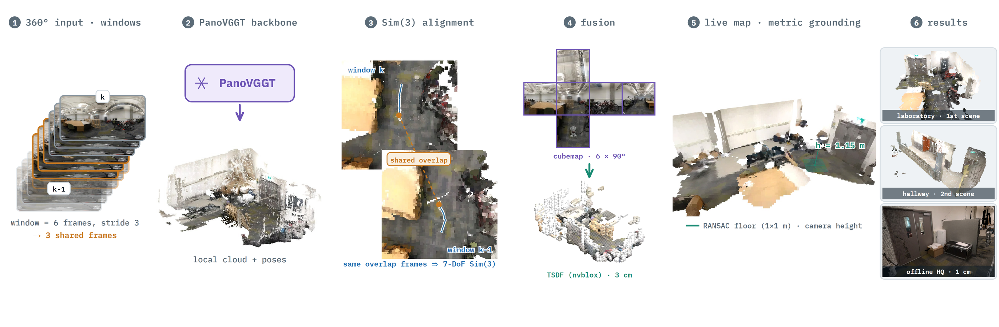
</p>

<p align="center"><sub>
The full pipeline: 360° video in overlapping windows (1) runs through PanoVGGT (2); the shared frames anchor a closed-form Sim(3) alignment (3); depth is fused into an nvblox TSDF through a six-face cubemap (4) and grounded to metric scale from the floor and a known camera height (5). Results (6): two real on-robot captures and one offline high-detail rebuild.
</sub></p>

## Overview

PRISM-VGGT (**P**anoramic **R**econstruction with **I**ncremental **S**LAM and Dense **M**odeling) turns a live 360° video stream into a dense, metric, globally consistent volumetric map. It wraps the pretrained panoramic model [PanoVGGT](https://github.com/YijingGuo-June/PanoVGGT) in a sliding-window streamer, stitches submaps with a closed-form similarity transform, and fuses them into a GPU TSDF with NVIDIA [nvblox](https://github.com/nvidia-isaac/nvblox), all within a bounded memory budget. Nothing in the engine is trained; the work is the alignment, fusion, and streaming built around the pretrained model.

It is the reconstruction core of **VAT** (Volumetric Asynchronous Telepresence), a low-bandwidth remote-inspection platform where a robot streams a thin 360° feed and the operator explores the reconstruction instead of the live video.

## Highlights

- **Panoramic input, 7-DoF alignment.** Pinhole systems such as VGGT-SLAM stitch submaps with a 15-DoF projective (SL(4)) transform because the camera calibration is unknown. A panorama has a fixed, known projection, so a 7-DoF similarity (Sim(3)) is enough. In an ablation that changes only the alignment group, SL(4) gives similar results (its fits stay within 1% of a similarity), while freezing the scale (SE(3)) is 2-3x worse.
- **Does not get lost.** On 18 rendered Replica walks it tracks 98-99% of 2 m stretches and stays within 30 cm on all 18, where the pinhole streaming baselines lose track or drift. On a real 285 m walk with lidar ground truth, its local map error is 9 cm against 41-86 cm.
- **Fixed work per window.** Windows are folded into the volumetric map as they arrive, so inference work per window is fixed and GPU memory follows the mapped volume (13.5-14.9 GB on Replica scenes, 26.6 GB on the 285 m real walk), while offline batch methods keep growing with every frame.
- **Metric without a ranging sensor.** Absolute scale comes from a RANSAC floor fit and the known camera height. Scale error was 2.0-2.3% on the rendered walks and 1.1% on the real 285 m walk.
- **Dense, streamable output.** A single TSDF instead of a per-view point map, exposed as a versioned per-block point cloud with content hashes, so a client downloads only what changed. An optional ESDF is available for navigation.
- **Runs on a real robot.** Deployed on a Unitree Go2-W carrying a RICOH Theta X, streaming to a cloud GPU and fused live at 3 cm voxels.

## How it works

**Sliding windows.** Video is processed in windows of a fixed number of frames that overlap, so consecutive windows share several frames. Those shared frames are what tie one submap to the next. Inference on window *k+1* runs while window *k* is being fused, as a one-deep double buffer.

**Why a similarity is enough.** For an uncalibrated pinhole camera, a reconstruction is only defined up to a 15-DoF projective transform; eight of those degrees of freedom come from the unknown focal length. An equirectangular pixel back-projects to a fully determined ray, so those eight never appear and two overlapping panoramic submaps differ by scale, rotation, and translation only. PRISM-VGGT solves that transform in closed form (a robust, weighted Umeyama fit) from the dense, pixel-corresponded 3D points of the overlap frames, with no factor graph. Every alignment group in the ablation (Sim(3), SE(3), SL(4)) is fit from these same correspondences, so the study changes only the group. Because the backbone is a learned model, this geometry is the motivation and the alignment-group study is the evidence.

**Drift guards.** The world is levelled on the first window (from the most confident floor in the window, or from the upright camera's own down axis when no floor is visible, refined to the first confident floor before anything is fused). The metric scale is committed after a short warm-up from the agreement of the floor-derived world-to-metric ratios, overlap poses are pinned, a flip guard rejects orientation jumps, and a re-levelling guard keeps the floor at constant height. There is no loop closure yet. See [docs/PRISM_V2_CHANGES.md](docs/PRISM_V2_CHANGES.md) for the environment flags.

**Metric grounding.** Each window's lower hemisphere is fit with a floor plane by RANSAC; scale is the measured camera height divided by the camera-to-floor distance, taken as a running median over the first confident windows and then held.

**Equirectangular fusion.** nvblox only integrates pinhole depth, so each panorama is reprojected onto six 90° cube faces, radial depth is converted to per-face optical depth, seams and depth discontinuities are masked, and each face is integrated with its own rotated pose.

<p align="center">
  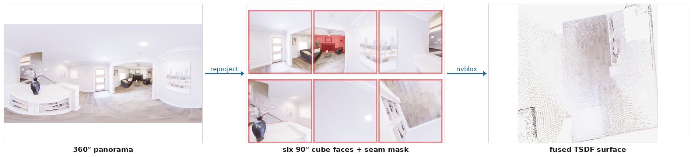
</p>

<p align="center">
  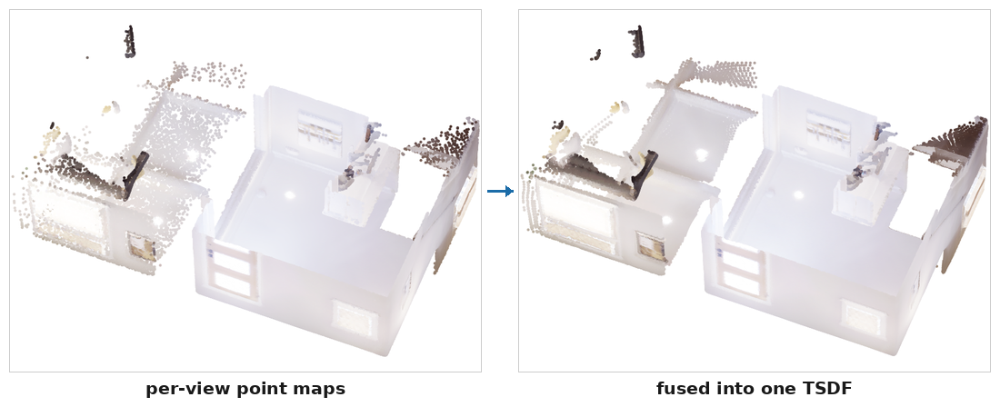
</p>

## Results

These results are from the PRISM manuscript (in preparation, October 2026). The benchmark harness is public at [PRISM-benchmarks](https://github.com/zRafaF/PRISM-benchmarks), and all inputs, raw outputs and scores are on [Hugging Face](https://huggingface.co/datasets/DoninhaD/prism-bench-inputs).

**Setup.** 18 rendered walks through six [Replica](https://github.com/facebookresearch/Replica-Dataset) scenes (four rooms and two multi-room apartments, three walks each, 0.5 m/s sampled at 2 Hz), and a real 285 m handheld walk from the [360Loc](https://arxiv.org/abs/2311.17389) atrium with lidar ground-truth poses and a reference map fused from its depth maps. Baselines are LASER and VGGT-SLAM 2.0 on a forward pinhole view (and, as a diagnostic, on the same 360 capture as cube faces), with full-batch PanoVGGT and Pi3X for reference. Streaming methods ran on an RTX 5090 (32 GB). Besides trajectory error we measure whether a system gets lost (share of 2 m stretches tracked, and whether it stays within 30 cm after aligning on the first 2 m) and score each map by its own best-fit alignment, globally and tile by tile.

| Data | Method | Map acc. (cm) ↓ | Local (cm) ↓ | F@5 cm ↑ | ATE ↓ | Tracked (%) ↑ | Within 30 cm ↑ |
| --- | --- | :---: | :---: | :---: | :---: | :---: | :---: |
| Rooms (12 walks) | VGGT-SLAM 2.0 | 8.8 | 8.3 | 0.49 | 30.9 cm | 22 | 0/12 |
| | LASER | 6.0 | 5.5 | 0.69 | 15.0 cm | 85 | 2/12 |
| | **PRISM** | **1.3** | **1.0** | **0.95** | **1.9 cm** | **99** | **12/12** |
| Apartments (6 walks) | VGGT-SLAM 2.0 | 19.8 | 19.7 | 0.20 | 166.8 cm | 26 | 0/6 |
| | LASER | 15.7 | 13.2 | 0.41 | 41.2 cm | 93 | 0/6 |
| | **PRISM** | **2.4** | **1.8** | **0.86** | **4.7 cm** | **98** | **6/6** |
| Real atrium (285 m) | VGGT-SLAM 2.0 | 66.1 | 41.5 | 0.00 | 14.4 m | 69 | 0/1 |
| | LASER | 93.0 | 85.6 | 0.02 | **1.6 m** | **99** | 0/1 |
| | **PRISM** | **21.4** | **9.4** | **0.12** | 2.0 m | 96 | 0/1 |

<sub>Map acc.: median distance to the reference after each map's own best-fit placement. Local: median error after re-aligning 2 m tiles (5 m on the real walk) on their own. F@5 cm: in the region the pinhole camera observed. Tracked: share of 2 m stretches with RMSE below 5 cm and rotation within 5°.</sub>

- **Getting lost.** PRISM tracks 98.8% (rooms) and 97.8% (apartments) of 2 m stretches and stays within 30 cm on all 18 rendered walks. VGGT-SLAM 2.0 tracks 22-26% of stretches, and LASER stays within 30 cm on 2 of 18 walks.
- **Maps.** On the rendered walks PRISM's map error is about 5-7x lower than the streaming baselines', and the gap remains after tile-wise registration, so it is not just a global offset.
- **Real walk.** Local map error is 9 cm against 41-86 cm, and scale error is 1.1%. Without loop closure the trajectory is not more accurate than LASER's (2.0 vs 1.6 m ATE). It drifts smoothly around the long loop, which bends the far end of the map while leaving it locally intact. With its 4.5 m fusion range PRISM also covers less of the atrium (regional recall 0.51 against 0.78 for full-batch PanoVGGT).
- **Alignment group.** SL(4) gives similar results (one seed; its fits stay within 1% of a similarity), while freezing the scale (SE(3)) is 2-3x worse. The similarity is sufficient, and the scale must stay free.
- **Cost.** 5.7 timesteps/s (3.3 including model loading) on an RTX 5090, above the 2 Hz input, with 13.5-14.9 GB peak on Replica and 26.6 GB on the larger atrium map.

## Gallery

<table>
  <tr>
    <td colspan="2" align="center">
      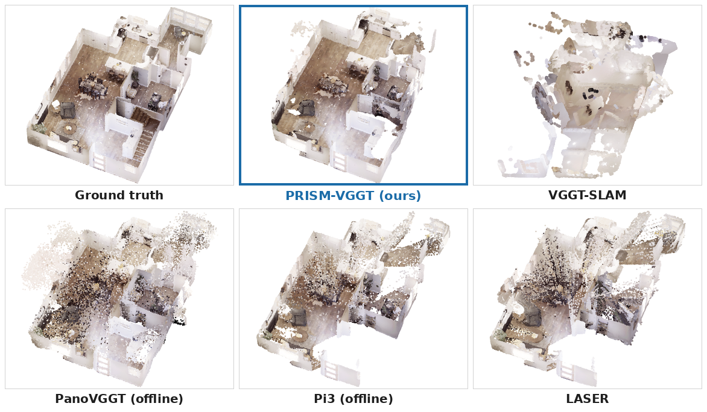<br>
      <sub>Replica apartment_0, smooth walkthrough at 2 Hz, from an earlier benchmarking round (its VGGT-SLAM panel is from a single-submap run). Current numbers are in Results.</sub>
    </td>
  </tr>
  <tr>
    <td colspan="2" align="center">
      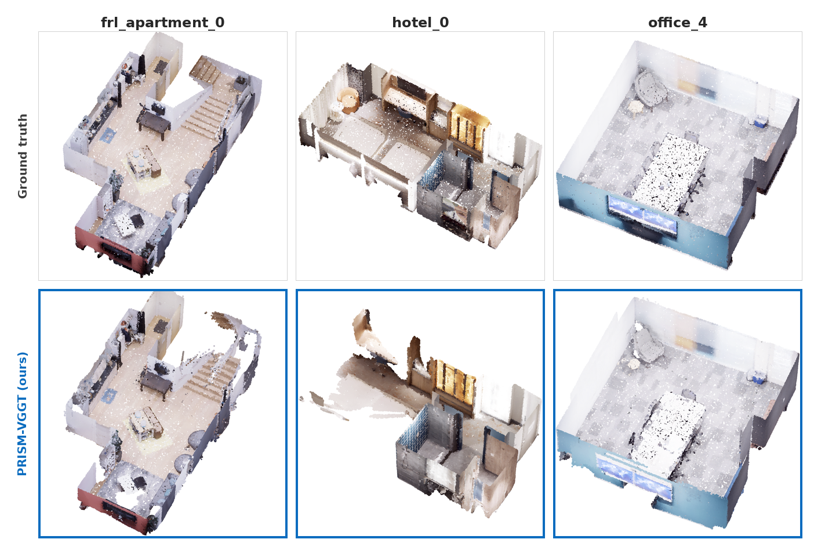<br>
      <sub>Ground truth (top) and PRISM-VGGT (bottom) on three more Replica scenes.</sub>
    </td>
  </tr>
  <tr>
    <td width="50%" align="center">
      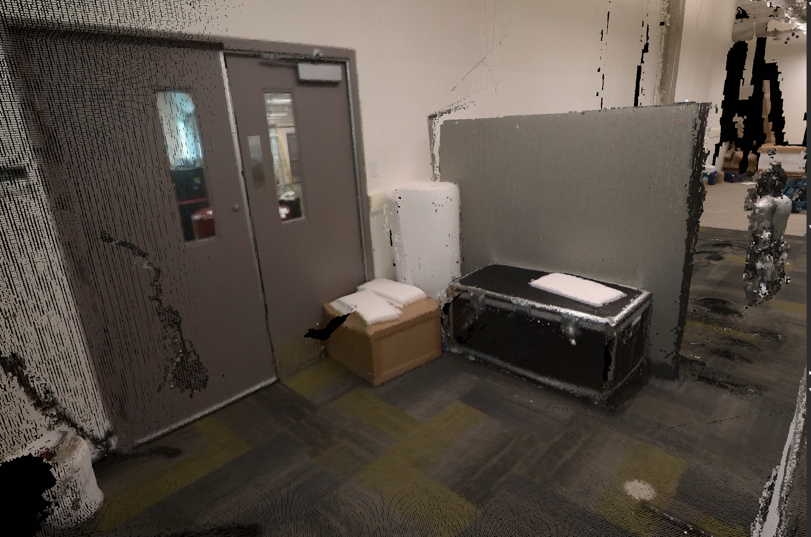<br>
      <sub>Real lab capture, offline rebuild at a fine voxel size.</sub>
    </td>
    <td width="50%" align="center">
      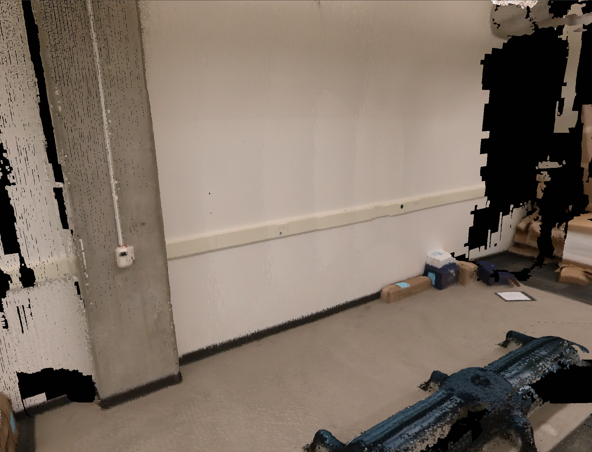<br>
      <sub>Real lab capture, wall and floor detail.</sub>
    </td>
  </tr>
  <tr>
    <td width="50%" align="center">
      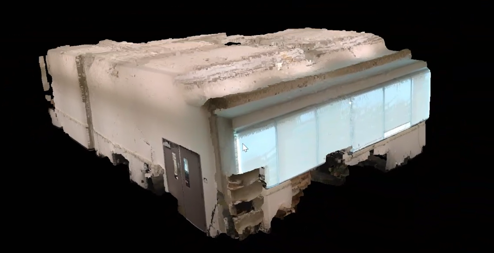<br>
      <sub>The fused lab volume seen from outside.</sub>
    </td>
    <td width="50%" align="center">
      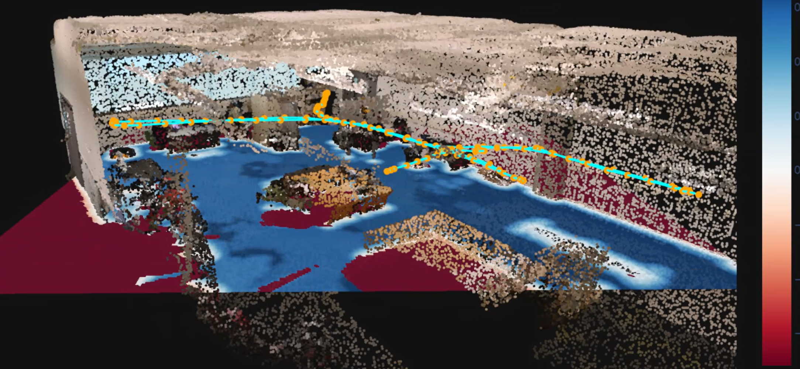<br>
      <sub>ESDF slice and camera trajectory over the lab map.</sub>
    </td>
  </tr>
  <tr>
    <td colspan="2" align="center">
      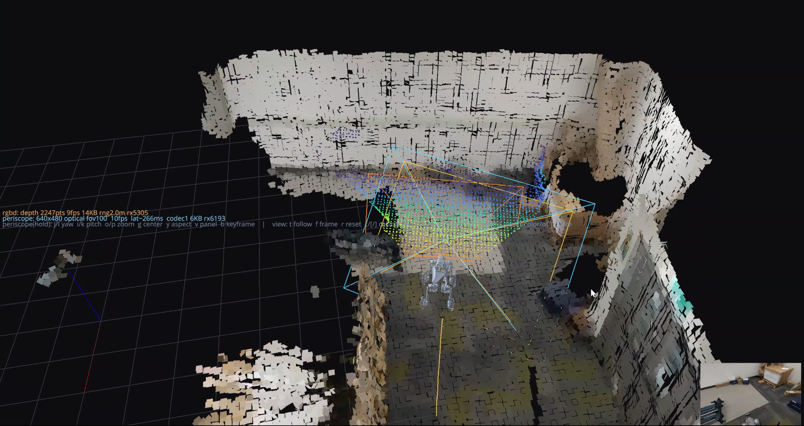<br>
      <sub>The VAT operator client: the robot is drawn inside the live reconstruction, with its sensor frusta and a periscope view.</sub>
    </td>
  </tr>
  <tr>
    <td colspan="2" align="center">
      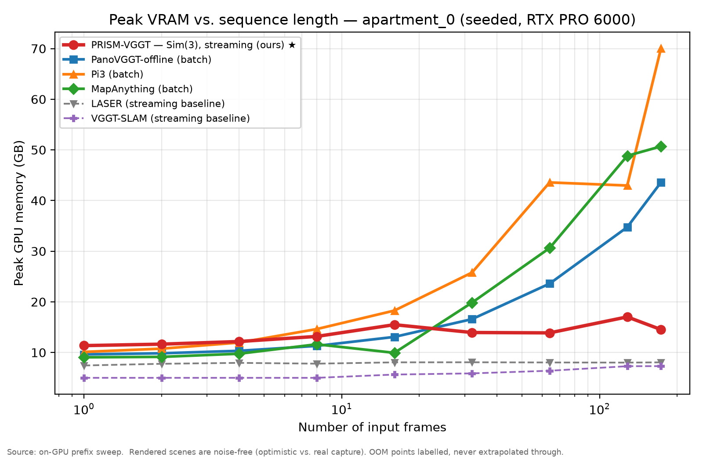<br>
      <sub>Peak GPU memory against input length. Batch methods grow with the sequence; PRISM-VGGT and the streaming baselines stay bounded.</sub>
    </td>
  </tr>
</table>

## Limitations

- There is no loop closure yet, so the trajectory drifts on long loops (2.0 m ATE on the 285 m real walk). The map stays locally consistent but bends at the far end. The next step is detecting revisits from overlapping geometry, optimising a Sim(3) graph over windows and warping the fused map.
- Metric scale comes from a floor fit and a known camera height; the sensitivity to a wrong height has not been measured.
- Depth was fused only up to 4.5 m in these runs, so in large spaces it maps a corridor around the path.
- Rendered frames are noise-free and level, and the real result is a single walk, a check of transfer rather than a statistic.

## Requirements

- **OS:** Linux (Ubuntu 24.04 / Debian)
- **GPU:** NVIDIA GPU with CUDA 12.8 support (compute capability 7.5 or higher). Tested on Blackwell (RTX PRO 6000, sm_120/sm_122).
- **CUDA:** 12.8 (the image `nvidia/cuda:12.8.0-cudnn-devel-ubuntu24.04` is known to work)
- **Python:** 3.12

> **Why CUDA 12.8?** Blackwell GPUs (RTX 50-series, RTX PRO 6000) need `sm_120`/`sm_122` kernels, which first ship in PyTorch's `cu128` build (`torch==2.8`). Older `cu124` wheels fail with *"no kernel image is available for execution on the device"*.

## Installation

The project uses a git submodule, so clone recursively, then run the setup script:

```bash
git clone --recurse-submodules https://github.com/zRafaF/PRISM-VGGT
cd PRISM-VGGT
chmod +x setup.sh scripts/build_nvblox.sh
./setup.sh
```

Setting up the reference Docker container (CUDA 12.8 / Ubuntu 24.04) and connecting over SSH? See [`docs/SERVER_SETUP.md`](docs/SERVER_SETUP.md).

### Choosing how nvblox is installed

`setup.sh` offers three ways to install `nvblox_torch`. Pick one with a CLI argument, the `NVBLOX_MODE` environment variable, or the interactive menu (non-interactive runs default to `prebuilt`):

| Mode | Command | When to use |
| --- | --- | --- |
| `prebuilt` *(default)* | `./setup.sh` | Standard hardware. Fastest. **Segfaults on Blackwell + cu128** (ABI mismatch). |
| `source` | `./setup.sh source` | **Blackwell / RTX PRO 6000.** Builds nvblox matched to your GPU arch, CUDA, and torch ABI. |
| `url` | `./setup.sh url` | Install a specific wheel (prompts, or set `NVBLOX_WHEEL_URL`). |

It also runs unattended, for example `NVBLOX_MODE=source ./setup.sh`. See [`docs/ADVANCED_NVBLOX.md`](docs/ADVANCED_NVBLOX.md) for source-build details and troubleshooting.

<details>
<summary><b>Manual installation and custom environments</b></summary>

1. Install [`uv`](https://docs.astral.sh/uv/): `curl -LsSf https://astral.sh/uv/install.sh | sh`
2. Sync the environment: `uv sync` (add `--extra apps` for the Gradio UI, `--extra benchmarks` for evaluation tools).
3. Download the weights. The library never downloads anything on its own:

   ```bash
   uv run python -c "from prism_vggt import download_weights; download_weights('checkpoints/model.pt')"
   ```

   Or manually: `wget -qnc https://huggingface.co/YijingGuo/PanoVGGT/resolve/main/model.pt -O checkpoints/model.pt`. If the checkpoint is missing, `PanoVGGTBackend` raises an error pointing to the line above.

By default `uv sync` installs an `nvblox-torch` wheel built for **Ubuntu 24.04 and CUDA 12.8**. That wheel uses a non-manylinux filename, so set `UV_SKIP_WHEEL_FILENAME_CHECK=1` (already exported by `setup.sh` and the container's `docker-compose`). To use a different wheel:

```bash
uv add "nvblox-torch @ <YOUR_CUSTOM_WHEEL_URL>"
```

On Blackwell GPUs with torch 2.8 + cu128 the prebuilt wheels segfault at `import nvblox_torch` because of a C++ ABI mismatch. Build from source with the venv active:

```bash
./scripts/build_nvblox.sh
```

See [`docs/ADVANCED_NVBLOX.md`](docs/ADVANCED_NVBLOX.md) and the [official nvblox documentation](https://nvidia-isaac.github.io/nvblox/public/pages/installation.html).

</details>

## Usage

Prefix commands with `uv run` so they use the locked environment.

### Interactive sandbox

```bash
uv sync --extra apps
uv run apps/gradio_ui.py
```

The Gradio app listens on port 7860 and also requests a public share link.

### Python library

The public API is two objects: a perception backend and the `StreamingWindowEngine` that fuses it into a dense map.

```python
from prism_vggt import PanoVGGTBackend, StreamingWindowEngine, FrameInput, download_weights

download_weights("checkpoints/model.pt")            # explicit, one-time
perception = PanoVGGTBackend(weights_path="checkpoints/model.pt")
engine = StreamingWindowEngine(perception, voxel_size=0.02, max_depth=4.5)
engine.processing_mode = "parallel"   # or "sequential" (lower peak VRAM)

# Each frame carries its image, validity mask, measured camera height, and a timestamp.
frames = [FrameInput(image=img, mask=msk, camera_height=h, timestamp=t)
          for img, msk, h, t in my_capture]

for mesh, pointcloud, trajectory, floor in engine.process_sequence(
    frames, window_size=16, overlap=4, generate_esdf=True
):
    print(f"Submap {engine.submap_count}: map version {engine.get_map_version()}")

timestamps, poses = engine.get_poses()   # (N,), (N,4,4) timestamped camera poses
```

<details>
<summary><b>Streaming the map to a client, ESDF, and performance knobs</b></summary>

**Deltas and snapshots.** The map is exposed as one colored point per ~5 cm block, with a monotonic version and per-block content hashes, so a client can stream only what changed and resync after a dropped update:

```python
delta = engine.get_point_cloud_delta(since_version=client_version)
#   -> {"points", "colors", "keys", "block_hashes", "version", "from_version"}

snap = engine.get_point_cloud_snapshot()
#   -> {"points", "colors", "keys", "block_hashes", "version", "map_hash"}
```

The library does not do networking; it provides stable block ids, per-block hashes, and a map version for your transport layer. Block removal (for example via TSDF decay) is not tracked yet.

**Collision distances (ESDF).**

```python
engine.compute_esdf = True                  # recompute the ESDF each submap (off by default)
# ... after running process_sequence ...
sl = engine.get_esdf_slice(height=1.0)      # horizontal slice, Z-up, floor at 0
# sl -> {"xs", "ys", "distance" (Hy x Wx, meters), "z", "valid"}
```

The world frame is Z-up and right-handed (ROS REP-103 / nvblox): the floor is at `Z = 0` and an upright camera sits at `Z ≈ camera_height`.

**Performance.** Perception (GPU inference) and mapping (TSDF, mesh, color) run as a one-deep A/B double buffer: while window *k* is mapped, window *k+1* is inferred. Windows are consumed strictly in order and none is skipped. Other knobs: `engine.point_cloud_only` (skip the per-submap mesh), `engine.mesh_extract_every` (amortize mesh rebuilds), and `engine.face_size` (cubemap resolution).

</details>

## Acknowledgments

PRISM-VGGT was built at the SITE Laboratory, Department of Civil and Environmental Engineering, University of Alberta, under the supervision of Dr. Qipei Mei, during an international research internship by Rafael Farias Meneses (UTFPR) supported by Fundação Araucária through the Getting the World of Science (GWS) program. Thanks to Yuezhen Gao and Huyue Li (University of Alberta) and Prof. Fábio Rizental Coutinho (UTFPR) for their collaboration, and to the SITE Laboratory for computing resources.

The engine builds on [PanoVGGT](https://github.com/YijingGuo-June/PanoVGGT), [VGGT](https://github.com/facebookresearch/vggt), and [nvblox](https://github.com/nvidia-isaac/nvblox). It started as a spinoff of [LASER](https://github.com/neu-vi/LASER) and was redesigned around ideas from [VGGT-SLAM](https://github.com/MIT-SPARK/VGGT-SLAM).
